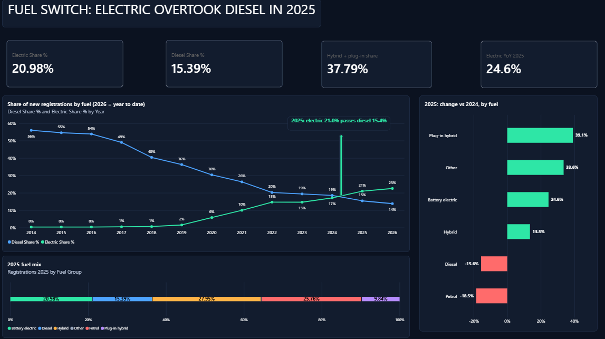
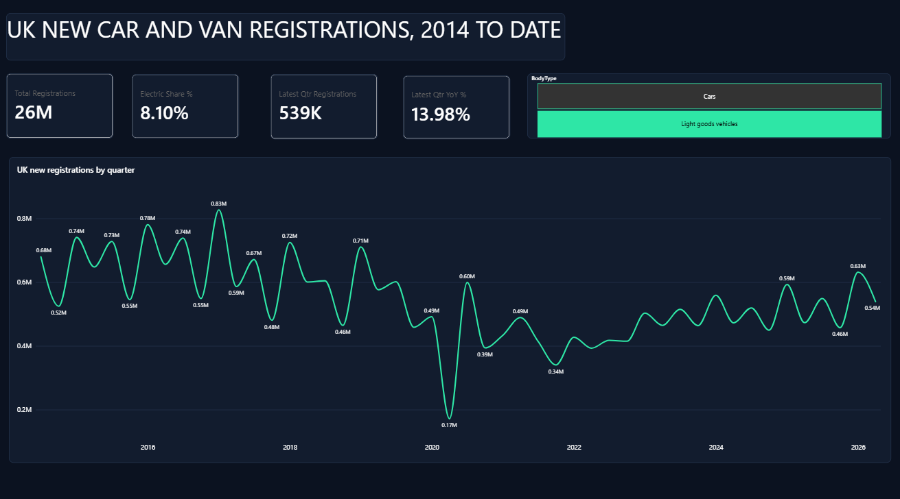
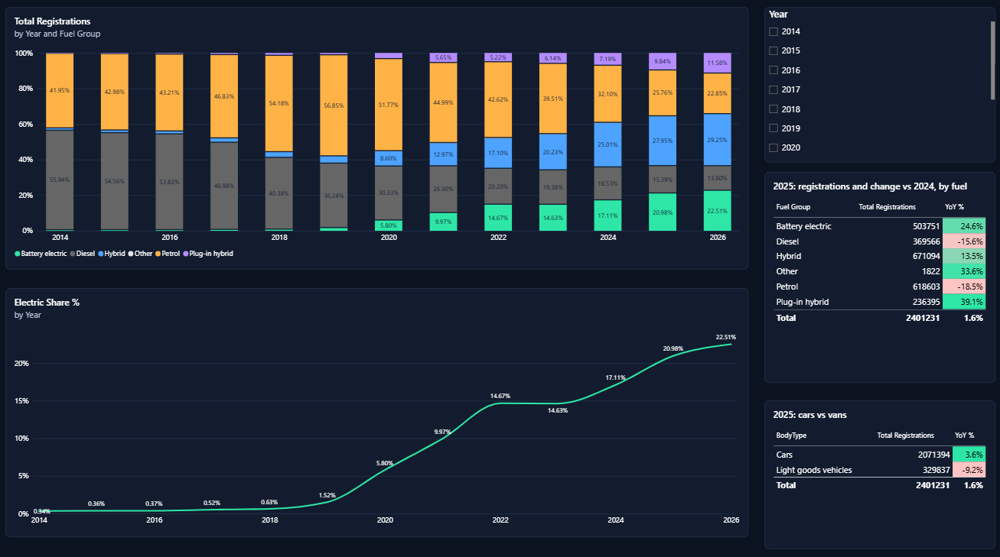
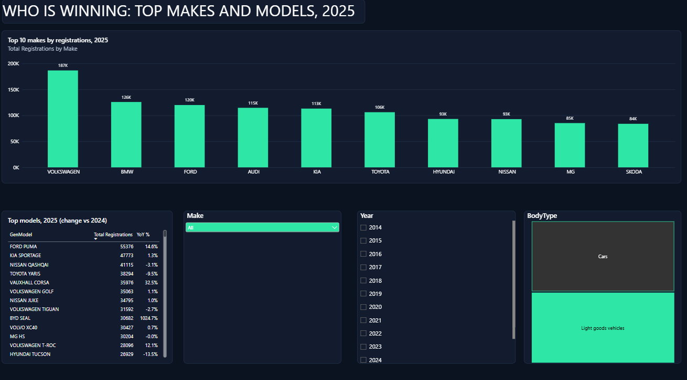

<h1 align="center">UK New Car and Van Registrations</h1>

  <b>Electric overtook diesel in 2025.</b> 
  A four-page Power BI dashboard on how the UK new vehicle market has changed since 2014.

  
  
  
  

  

> **Scenario:** This is a portfolio project. The business case (a fleet company deciding what vehicles to buy) is fictional. **The data is real and public.**

---

## At a glance

| Electric share, 2025 | Diesel share, 2025 | Electric growth, 2025 | New registrations, 2025 |
|:---:|:---:|:---:|:---:|
| **20.98%** | **15.39%** | **+24.6%** | **2,401,231** |
| up from 0.34% in 2014 | down from 55.94% in 2014 | diesel fell 15.6% | +1.6% on 2024 |

---

## Business question

> Which vehicles and fuel types is the UK market moving towards, and which makes are winning?

---

## Key findings

| # | Finding | Evidence |
|:---:|---|---|
| 1 | **Electric overtook diesel in 2025** | 20.98% vs 15.39%. In 2024 diesel was still ahead (18.53% vs 17.11%). |
| 2 | **Electric went from almost nothing to about one in five** | 0.34% (2014) to 20.98% (2025). 22.51% so far in 2026. |
| 3 | **Diesel has collapsed** | 55.94% (2014) to 15.39% (2025). In 2025 diesel fell 15.6% and petrol fell 18.5%. |
| 4 | **Hybrids are growing fast too** | In 2025 plug-in hybrid grew 39.1% and battery electric 24.6%. Hybrid and plug-in hybrid together were about 38% of registrations. |
| 5 | **The market has not recovered to its pre-2019 size** | Quarterly registrations peaked at about 0.93M (2017), fell to about 0.21M (2020) and now sit at 0.5M to 0.6M. Latest quarter: 621K, up 13.27% on the same quarter last year. |
| 6 | **Cars grew while vans fell** | Cars 2,071,394 (+3.6%). Vans 329,837 (-9.2%). |
| 7 | **Volkswagen leads by a wide margin** | VW 187K, BMW 126K, Ford 120K, Audi 115K, Kia 113K. Best-selling model: Ford Puma (55,376, +14.6%). |

---

## Dashboard pages

| Page | Question it answers |
|---|---|
| **1. UK new car and van registrations, 2014 to date** | How big is the market and how has it changed? |
| **2. Electric and hybrid are replacing diesel** | Which fuel types are rising and falling? |
| **3. Who is winning** | Which makes and models lead in 2025? |
| **4. Fuel switch: electric overtook diesel in 2025** | When did electric pass diesel, and which fuels grew or fell in 2025? |

<b>Show all four pages</b>

 

---

## What I built

- **Power Query:** cleaned and reshaped the data (unpivot, filters, a custom Fuel Group column).
- **Date table:** created and linked to the data for time analysis.
- **DAX measures:** Total Registrations, Fuel Share %, Electric Share %, Year-on-Year %, Latest Quarter figures, and 2025 comparison measures.
- **Dark theme:** a custom JSON theme used on all four pages.
- **Report pages:** four pages with slicers, conditional formatting (negative bars in red) and labelled charts.
- **BRD:** a Business Requirements Document for the fictional fleet client.

## Checking the numbers

The 2025 total (**2,401,231**) was matched in **Power BI, Excel and MySQL**. The SQL check also caught a slicer on page 1 that was filtering to cars only, which I fixed. The queries are in [`analysis_queries.sql`](analysis_queries.sql).

## Recommendations (for the fictional fleet client)

1. **Plan for a smaller diesel share.** It is falling fast every year, so do not build a long-term buying plan around it.
2. **Include hybrids and plug-in hybrids, not just full electric.** They are growing faster than the market.
3. **Prefer popular makes and models** for resale and availability. The top makes hold a large share.

## Limitations

- The data covers **new registrations only**. It does not cover used cars and does not separate private, company or leasing buyers.
- **2026 is a partial year**, so 2026 shares are year to date.
- Growth rates for new models (for example BYD Seal, +1024.7%) come from a very small 2024 base. Read them with care.
- The data does not explain **why** changes happened. Possible causes such as regulation or fuel prices are not tested here.

---

## Files

| File | What it is |
|---|---|
| `UK_Fleet_Dashboard.pbix` | The Power BI dashboard |
| `BRD_UK_Vehicle_Registrations.docx` | Business Requirements Document |
| `UK_Fleet_Dashboard_Theme_Dark_v2.json` | The custom dark theme |
| `analysis_queries.sql` | MySQL queries: checked ones plus extra analysis |
| `Dashboard_1.png` to `Dashboard_4a.png` | Screenshots of each page |

## Data source

Department for Transport and DVLA, *Vehicle licensing statistics* (new registrations by make, model and fuel type). Contains public sector information licensed under the [Open Government Licence v3.0](https://www.nationalarchives.gov.uk/doc/open-government-licence/version/3/).

## Next steps

- Extend the SQL analysis (fuel groups, electric share, year-on-year) and repeat it in Python.
- Add a regional view.

---

  <b>Amosh Roopsingh</b> · Business Analyst · Birmingham, UK  
  <a href="https://www.linkedin.com/in/amosh-roop-singh-business-analyst/">LinkedIn</a> ·
  <a href="https://github.com/amoshr">GitHub</a>

